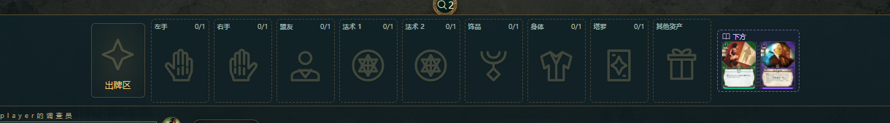
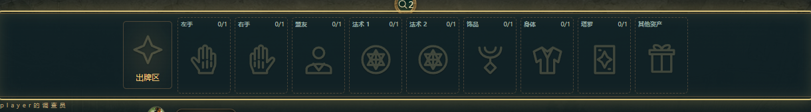
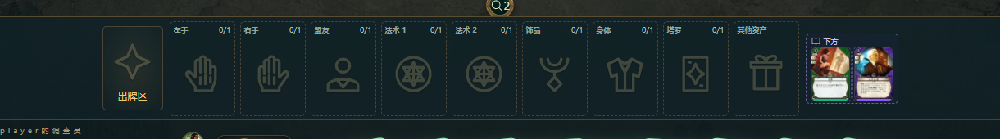

# 「下方」卡牌刷新时消失/重现 —— 诊断报告（task-2）

日期：2026-10-26 · 调试员：beneath-flicker · 环境：真实大厅 `http://127.0.0.1:8799`（复用，未重启） + Playwright 1.63 / 系统 Edge，1700×950 @DPR1
用户版本：mod v0.3.1（`games/arkhamhorror` HEAD `94515a5`）· 用户截图：`.tmp-ui-bug/screen.png`（红圈二）

---

## 1. 结论（TL;DR）

**不是 CSS 布局/裁剪问题，也不是卡图节点丢失，更不是刷新按钮本身的 busy 双渲染。**
根因是**演出（presentation）中间态快照缺失私有字段 `beneath`**：

1. 引擎每次发演出提示时用 `captureTableState()` 抓一份「演出快照」塞进事件的 `presentation.tableState`（`src/engine/engine.js:260`）或顶层 `tableState`（`src/engine/dispatch.js:143` 的 checkpoint）。v0.3.1 的 `captureTableState()` 的 `INV_FIELDS` / 调查员映射**没有 `beneath`、`beneathCount`**（`src/integration/presentation-state.js:36,80-85`）。
2. 客户端 `table-presentation.js` 的 `applyStep()` 会把这份快照直接合并进 `displayed.state`：
   `displayed = { ...displayed, state: { ...displayed.state, ...change.tableState, revision, … } }`（`web/table-presentation.js:126-132`）。
   由于快照里的 `investigators` 是**整个数组**，旧数组里本来正确的 `beneath` 被整体替换成「没有 beneath 的调查员对象」。
3. `applyStep()` 随即 `onChange() → render()`（整树重绘）。`renderPlayerDock()` 里 `const beneath = Array.isArray(inv.beneath) ? inv.beneath : []`（`web/game-ui.js:1439`）此时得到 `[]`，于是 `beneath.length ? h('.ah-beneath-row' …) : null`（`web/game-ui.js:1451-1454`）**整排「下方」栏不渲染**。
4. 这个「缺字段的中间态」会一直停留在 `displayed` 上陪跑后续所有排队演出；直到 `drain()` 结束 `displayed = latest; block(false); onChange()`（`web/table-presentation.js:731-733`）才恢复——所以「消失」的时长 = 剩余演出时长。

实测：一次裸 checkpoint ≈ 40ms；一段短演出队列 1.5s；结束回合的敌方/重整/神话阶段演出 **6.2s**；带「阅读型」剧情页时可 **>18s**。这与用户「刷新时右侧下方卡牌时不时消失再出现」完全吻合。

**任何会回放未消费演出事件的路径都会触发**，不只是「刷新局势」按钮：点刷新只是最容易把积压的 revision + events 一次性回放出来（AI 结算、自动结算、结束回合、断线重连后同理）。所以是「时不时」——取决于这次刷新是否带回新的 checkpoint 演出事件；如果服务端没有新 revision（纯重绘），永远不会闪。

修复：在 `captureTableState()` 里带走 `beneath`/`beneathCount`，并在 `projectTableState()` 里对非观察者清空 `beneath`（否则泄露别人的私有区）。**该修复已在当前工作树（Lead 的 task-3）实现**；A/B 浏览器验证：修复前 5.0s 消失，修复后 0ms。

---

## 2. 可复现步骤（真实对局，非 stub）

### 2.1 最快复现（刷新局势）

1. 真实大厅开局：`POST /api/start`（`legacyAutoStart:true, playerCount:1, playerInvestigator:'03003'` 赛菲娜·卢梭；她的开局能力会真实地把事件牌压在自己下方，等价于黛安娜用反应压牌）。
2. 走完开局「选择至多 5 张事件放在赛菲娜下方」→ 牌桌右侧出现 `.ah-beneath-row`（每次随机，本次实测 1~4 张）。
3. 让 UI 落后服务端数个 revision（模拟 AI/自动结算已推进、客户端还没消费演出事件）：直接对 `/api/move` 连发几条真实 move（例如 3 次 `{action:'resource'}` 会花完行动点并自动结束回合，引擎连发敌方→重整→神话阶段演出）。
4. 点牌桌右上角 **↻「刷新局势」**（或直接点「结束回合」走正常流程）。
5. 观察：`.ah-beneath-row` 在演出开始后的第一次中间态渲染中**整排消失**，直到演出队列播完才重新出现；期间服务端 `GET /api/session` 的 `state.investigators[0].beneath` **一直存在**。

参考命令（脚本都在 `.tmp-ui-bug/reports/`）：

```bash
node .tmp-ui-bug/reports/recon-start.mjs 03003 1        # 起真实对局并真实压牌到下方
node .tmp-ui-bug/reports/beneath-uiturn.mjs 1700 950     # 正常「结束回合」→ 6.2s 消失
node .tmp-ui-bug/reports/beneath-evidence2.mjs 1700 950            # 刷新复现 + 前/中/后截图（control）
node .tmp-ui-bug/reports/beneath-evidence2.mjs 1700 950 patched    # 模拟修复后：0 消失
node .tmp-ui-bug/reports/beneath-ab.mjs control 1700 950           # A/B：5.0s 消失
node .tmp-ui-bug/reports/beneath-ab.mjs patched 1700 950           # A/B：0ms
node .tmp-ui-bug/reports/monitor.mjs bg-4-mvpc2wer 1700 950        # 60fps 帧级+DOM 监控（含其它刷新路径）
```

### 2.2 关键截图（本次真实对局）

| 状态 | 下方栏 |
| --- | --- |
| 点「结束回合」前（2 张下方牌） |  |
| 演出回放中（整备阶段演出条在顶部，**「下方」栏消失**） |  |
| 演出队列播完（下方栏恢复，同样是 2 张牌） |  |

全屏证据：`evidence/uiturn-2-during.png`（可见顶部「整备阶段 · 自动结算」演出，右侧战场在「其他资产」后就结束了，没有「下方」栏）、`evidence/uiturn-3-after.png`（恢复）。
刷新路径的同款前/中/后证据：`evidence/refresh-1-before.png`、`evidence/refresh-2-during-gap.png`、`evidence/refresh-3-after-gap.png`，以及战场裁剪 `evidence/refresh-*-battlefield.png` 和单卡裁剪 `evidence/refresh-*-crop.png`。

---

## 3. 证据与测量

### 3.1 帧级监控（`monitor.mjs`，60fps rAF + MutationObserver，8046 帧）

- **纯重绘/普通刷新不会闪**：在 monitor 的 21 个 step 里，纯重绘/刷新类步骤（`refresh-1/2/3`、`refresh-spam-3` 共 6 次整树 render、`timeline-toggle`）中 `.ah-beneath-row` 从未消失，卡图节点全程 `data-image-state=displayable`；单次刷新只有 2 次 render（busy + final），都保留下方栏。
- **带回放事件的刷新必闪**：`direct-investigate-then-refresh` 中，`state.session` 从 rev5 刷新到 rev6（带一条 checkpoint 事件）。4 次 render 的第 3 次没有 `.ah-beneath-row`：
  - `t=29631 tableAdded revision=6 hasBeneathRow=false`（MutationObserver）
  - `t=29641–29680` 帧内 `rows=0`（`presenting=true`），随后恢复
  - 同一 step 内服务端 `beneath` 一直是 `["01051","01066"]`
- 通过 hook `Element.prototype.replaceChildren` 抓到的**调用栈直接指向 presentation**：

```
at Element.replaceChildren
at renderNow (app.js:548)
at render (app.js:516)
at onChange (game-ui.js:247)
at applyStep (table-presentation.js:131)     ← 关键
at play (table-presentation.js:658)
at drain (table-presentation.js:729)
```

### 3.2 A/B 对照（同一真实流程，唯一差异=checkpoint 快照里有没有 beneath）

`beneath-ab.mjs`：真实开局→真实压牌→把 UI 留在 rev5、服务端推进到 rev11（6 个新 revision，含 3 个 checkpoint + 结束回合演出）→ 点「刷新局势」→ 8 次 render，统计 `replaceChildren` 中缺 `.ah-beneath-row` 的 render 数以及帧级缺口。

| 指标 | control（= v0.3.1 服务端行为） | patched（把 beneath 写回快照，等价修复） |
| --- | --- | --- |
| 缺「下方」栏的 render | **6 / 8** | **0 / 8** |
| `rowGone` 帧级缺口 | **1 段，4970 ms** | **0 段，0 ms** |
| 服务端 state 的 beneath | 全程存在 | 全程存在 |

`beneath-evidence2.mjs`（真实压牌后连发 3 个 resource → 自动结束回合 → 点刷新）：

| 指标 | control | patched |
| --- | --- | --- |
| 刷新前下方栏 | 有（1 张） | 有（3 张） |
| 演出期间帧采样 | 第 2 帧起消失，缺口 1535 ms（手动跳过演出加速；自然不点则整段 18s+ 采样窗口内都不回来） | 200 帧 / ~30s 采样内 **一次都没消失** |
| 刷新后下方栏 | 恢复（1 张） | 一直存在（3 张） |

`beneath-uiturn.mjs`（**不点刷新**，正常 UI 点「结束回合」）：3032 帧中 876 帧无下方栏；单段缺口 7848→14049 = **6201 ms**，期间 `.ah-phase-scene` 演出在播；`presenting=true`，恢复时状态变为「请你替赛菲娜回答待决选择」。→ 证明这是演出回放的通用问题，不是刷新按钮特有。

### 3.3 数据层证据

- 运行中的 8799 服务器（21:54 启动，加载的是 v0.3.1 HEAD 代码）返回的真实 session：
  `GET /api/session?sessionId=bg-4-mvpc2wer` → `state.investigators[0].beneath = ["01051","01066"]`；
  同一响应里 `events[seq=6].presentation.tableState.investigators[0]` 有 `hand`（8 张）却**没有 `beneath` 字段**。
- HEAD 代码（v0.3.1）静态确认：`git show HEAD:src/integration/presentation-state.js`
  - `INV_FIELDS`（第 36 行）不含 `beneath`
  - `captureTableState()` 调查员映射（第 80-85 行）没有 `beneath`
  - `projectTableState()`（第 88-95 行）只清 `hand`
- 修复后（当前工作树）Node 单测：
  `captureTableState(...).investigators[0].beneath = ["01016","01087"]`、`beneathCount=2`；
  `viewEvents(...,0)` 本人视角保留、`viewEvents(...,null)` 旁观者 `beneath=[]`（隐私不泄露）。
- 回归测试（工作树已存在）：`tests/state-presentation.test.mjs :: 演出快照保留本人「下方」牌，其他座位只拿到公开张数` → **PASS**。
- 引擎级修复验证（工作树代码、不重启共享服务端）：`node .tmp-ui-bug/reports/node-fix-validation.mjs` 用真实引擎执行 `{action:'resource'}`，发出的 checkpoint 快照已带 `beneath:["01051","01066"]`、`beneathCount:2`；`viewEvents(...,0)` 本人投影可渲染下方栏，旁观者投影 `beneath=[]`（不泄密）。

### 3.4 消失期间「卡图闪一下」的次要原因（非根因）

`retainTableArt()`（`web/table-art.js:6-29`）只在上一次树里存在对应 `.ah-table-art` 时才能搬运节点。下方栏被中间态整排丢掉的那次 render 里没有下方卡图节点，于是下一次恢复时只能新建节点：观测到 `data-image-state: pending→loading→displayable` 在 ~4ms 内完成（缓存命中）。慢盘/慢网络下这会是第二层小闪烁；根因修掉后自然消失（下方栏不再被整排重建）。

---

## 4. 逐一证伪/证实任务给的 5 条假设

| # | 假设 | 结论 | 证据 |
| --- | --- | --- | --- |
| 1 | presentation 演出层对卡牌设 `visibility:hidden`/mask | **否**（不是本次原因） | `maskArrivals()` 只对 `draw` 的 `hand:${seat}:${handIndex}` 下发 mask（`table-presentation.js:114-120`）；`block()` 只隐藏 `cardTransits` 的目标（asset/hand 演出目标）；8046 帧监控中下方行/卡从未出现 `visibility/opacity/display` 异常（`rowHidden/cardHidden = 0`）。 |
| 2 | `cardMove` 的 500ms progress polling + `refreshCardSession` busy/final 两连 render 造成闪烁 | **触发条件之一，但不是根因** | 纯刷新（无新 revision）时 busy+final 共 2 次 render，全部保留下方栏、无异常（`refresh-1..3`）；缺口对应的 render 的调用栈是 `applyStep ← drain`，不是 `refreshCardSession`/`cardMove`。这些路径只是把「未消费的演出事件」送到客户端。 |
| 3 | 真实服务端投影里 `inv.beneath` 时有时无 | **部分证实，但精确定位在「演出快照」而非实时投影** | 每个 step 后 `GET /api/session` 的 `state.investigators[0].beneath` 始终存在；只有 `events[].presentation.tableState.investigators[].beneath` 缺失。客户端 `applyStep()` 用后者覆盖显示态。 |
| 4 | battlefield 横向溢出 + `justify-content:safe center` + `flex-shrink` 裁掉/移出下方行 | **正常宽度下否；窄宽度是另一个次要问题** | 1700/1400 宽无溢出、无裁剪（行 rect 完整落在 battlefield 内）。1000×900 时 battlefield `scrollWidth 936 > clientWidth 924`、`.ah-beneath-row` 被 `flex:0 1 auto` 压到 `min-width:62px`，2 张下方牌时第 2 张落在可视区外（273 帧 `cardViewportClip`），但整行仍在、只是需要内层横向滚动；用户窗口按截图约 1470 CSS px，不受影响。**不是用户看到「整排消失」的原因。** |
| 5 | 卡图 `data-image-state` 在重绘后丢失 / presentation `replaceWith` 抢走 art 节点 | **否（作为根因）** | 纯刷新中 `retainTableArt` 完整保留卡图节点（Lead 的 probe 与本次 monitor 均确认）；`liftCard/finishCards` 只搬运 hand/play 目标的 art。art 状态丢失只发生在下方栏已被中间态整排移除之后的恢复 render 上（3.4）。 |

补充：`.ah-beneath-row` 的 CSS（`player-dashboard.css:74-89`、`card-interactions.css:111-114`）在 1700 宽下实测行高 86px、完整可见，`beneathRowClipped=false`，与用户截图布局一致。

---

## 5. 最小修复 patch（建议；= 当前工作树已实现的 task-3 修复）

文件：`games/arkhamhorror/src/integration/presentation-state.js`

```diff
@@ captureTableState() —— investigators 映射（v0.3.1 第 83 行后）
       hand: [...inv.hand], handSize: inv.hand.length, deck: [], deckSize: inv.deck.length,
+      // 压在调查员底下的牌（黛安娜／赛菲娜）与手牌同为本人私有区：演出快照里必须带走，
+      // 否则客户端 applyStep 用中间态重绘时整排「下方」栏会消失一瞬，drain 结束才恢复。
+      beneath: [...(inv.beneath || [])], beneathCount: (inv.beneath || []).length,
       maxSanity: getMaxSanity(inv), effectiveStats: …

@@ projectTableState()（v0.3.1 第 91 行）
-  for (const inv of copy.investigators || []) if (inv.seat !== observer) inv.hand = []
+  for (const inv of copy.investigators || []) if (inv.seat !== observer) { inv.hand = []; inv.beneath = [] }
```

要点：

- 只改 `src/integration/presentation-state.js` 一个文件两处；无需改客户端 `table-presentation.js`。
- 必须**同时**加 `projectTableState` 那行：`captureTableState` 带上 `beneath` 后，若不按观察者清空，别的座位会看到他人下方牌的卡号（违反 `observation.js:208` 的「本人可见卡号、他人只见张数」约定）。清空 `beneath` 但保留 `beneathCount`，与实时投影一致。
- 等价写法：把 `'beneath','beneathCount'` 加进 `INV_FIELDS` 也可，但显式行更贴近现有「hand/handSize」的写法，且能顺带注释原因。
- 回归测试（工作树已有，`tests/state-presentation.test.mjs:124-141`）应保留：
  1) 本人快照带 `beneath`/`beneathCount`；2) `viewEvents` 后本人保留、他人 `beneath=[]` 但 `beneathCount` 保留；3) 旁观者（observer=null）`beneath=[]`。
- 同一类 bug 的其它潜在字段（本次未造成用户可见问题，可顺手排查）：`captureTableState` 的 `INV_FIELDS` 还缺 `handLimit`/`role`/`lolaDiscount`/`campaignId`/`deckName`/`autoBuilt`/`tomeActionUsed`/`onTheLam`/`fearExtraPaid`/`usedReactions`/`exploreOnlyActions`（`handSize` 已在映射里显式给出）；`FIELDS` 缺 `victoryDisplay`/`abilityUsage`/`usedActions` 等。它们若被 UI 在演出期间绘制，会出现同类「消失一瞬」。本次只按用户反馈修 `beneath`。

### 建议的附带加固（可选，不属于最小修复）

1. **客户端防御性合并**（防止未来服务端再漏字段）：`table-presentation.js` 的 `applyStep()` 合并 `tableState.investigators` 时按 seat 与 `displayed.state.investigators` 做浅合并（`{...oldInv, ...newInv}`），或在 `renderPlayerDock` 里对私有区字段缺失时回退到 `beneathCount`（只画张数占位）。但根因在服务端快照，优先改服务端。
2. **窄屏下方行裁剪**（1000px 左右、≥2 张下方牌时第 2 张需要内层滚动才能看到）：可把 `.ah-threat-row.ah-beneath-row { flex: 0 1 auto; }`（`player-dashboard.css:74`）改为按张数给 `flex-basis`/`max-width`，或让下方行排到装备槽前（窄屏已有 `order` 规则）。与本次反馈无关，单独评估。
3. **演出期间 art 节点复用**：下方行恢复的下一帧会新建卡图节点（缓存命中下 ~4ms）。若想彻底无闪，可在 `retainTableArt` 之外保留一份「本轮被丢弃的 art 节点池」按 key 复用；收益小、风险中，不建议现在做。

---

## 6. 验证状态与待办

| 项 | 状态 |
| --- | --- |
| v0.3.1 真实服务端行为复现（浏览器、真实对局、真实 beneath） | ✅ 控制组：6/8 render 无下方栏、4970ms 缺口；结束回合 6201ms 缺口；截图与 60fps 帧记录齐全 |
| 修复后行为（同一流程） | ✅ patched 组：0/8 render 无下方栏、0ms 缺口；3 张下方牌下 30s 采样无消失 |
| 数据层修复验证 | ✅ HEAD 无 `beneath`；工作树 `captureTableState` 带上、`projectTableState` 对旁观者清空；回归测试 PASS |
| 引擎级验证（无需重启服务端） | ✅ `node .tmp-ui-bug/reports/node-fix-validation.mjs`：用工作树引擎真实执行 `{action:'resource'}`，发出的 checkpoint 快照 `investigators[0].beneath=["01051","01066"]`、`beneathCount=2`；`viewEvents(...,0)` 本人可渲染下方栏，旁观者 `beneath=[]` 且保留张数 |
| 真实服务的最终验收 | ⏳ **运行中的 8799 服务器仍是 21:54 启动的 v0.3.1 代码（修复文件写于 22:13，未被加载）**。`task-3` 需要重启大厅/重载 mod 后，用同样的「结束回合 / 刷新局势」流程确认修复生效；本报告的控制组正是用户版本的行为。 |
| 测试门禁 | ⏳ 需要 Lead 在 `games/arkhamhorror` 下跑 `npm run test:fast`（`state-presentation.test.mjs` 已含回归用例），并按需更新 `tests/view-privacy.test.mjs` 相关断言（若原来断言 `beneath` 不出现在快照里则要改）。 |

---

## 7. 复现脚本与产物清单

脚本（`.tmp-ui-bug/reports/`）：

| 脚本 | 作用 |
| --- | --- |
| `recon-start.mjs` | 用真实大厅开局（默认赛菲娜 03003，可传调查员/人数），并真实完成「放事件到下方」开局选择 |
| `monitor.mjs` | 60fps rAF + MutationObserver 监控：暂停 `.ah-beneath-row` 是否存在/可见、art `data-image-state`、table render 次数、`replaceChildren` 记录；覆盖 21 个刷新/重绘/真实操作 step |
| `beneath-ab.mjs control\|patched` | A/B 证明：control=服务端原样事件（4970ms 缺口），patched=客户端改写 checkpoint 快照补 `beneath`（0 缺口）；并打印缺行 render 的调用栈 |
| `beneath-evidence2.mjs control\|patched` | 刷新路径前/中/后全屏+裁剪截图，输出 `evidence.json` |
| `beneath-uiturn.mjs` | 正常 UI「结束回合」复现：3032 帧中 876 帧无下方栏、缺口 6201ms |
| `build-evidence.ps1` | 汇总裁剪图与 `measurements.json` |
| `node-fix-validation.mjs` | 不重启共享服务端，直接跑工作树引擎：真实 move 的 checkpoint 快照已验证带上 `beneath`/`beneathCount`，且旁观者投影被正确清空 |

原始产物：`.tmp-ui-bug/reports/out/{monitor-*,ab-*,evidence2-*,uiturn-*}/`（帧级 JSON + 截图）
报告证据包：`.tmp-ui-bug/reports/evidence/`（截图 + `measurements.json`）

真实 session：`bg-4-mvpc2wer`（赛菲娜，2 张下方牌，rev6，用于事件快照取证）、`bg-20-mvpca8b5`（A/B control）、`bg-45-mvpcgxv0`（结束回合 6201ms 缺口）。

---

## 8. 对 task-2 原始排查方向的最终回答

- 「DOM 被移除 vs 隐藏/裁剪 vs 图片丢失 vs 数据消失」→ **数据（演出中间态快照）消失导致 DOM 条件渲染整排不渲染**；不是 CSS 隐藏/裁剪，也不是图片节点被抢。
- 「是否正常动画」→ 不是。演出期间本应显示「当前已公开的稳定状态」，而不是把私有区字段抹掉的中间态；用户看到的是 bug。
- 修复落地位置：`games/arkhamhorror/src/integration/presentation-state.js` 的 `captureTableState()` + `projectTableState()`（见 §5），客户端无需改动。
