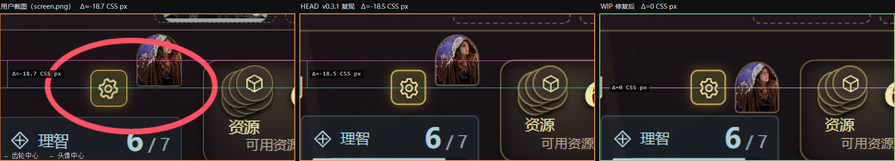

# 左下方玩家面板「头像 / 齿轮区域被挤开」诊断报告（task-1）

> 结论先行：**这不是刷新瞬间的动画/DOM 抖动问题，而是 v0.3.1（HEAD `94515a5`）玩家面板里调查员头像与三态齿轮的静态垂直错位。** `.ah-dock-portrait` 仍按旧版 `position:absolute; top:0; right:0` 对齐到「kicker 行顶部」，而 commit `9b7ab72` 新加的 `.ah-reaction-mode` 齿轮在下面一行 `.ah-dock-name-row` 里垂直居中，两者中心相差 **18.5 CSS px**。用户截图（红圈一）里量到的偏差是 **18.4–19.0 CSS px**，与 HEAD 复现的 18.5 px 一致（误差 < 0.5 px）。把头像移进名字行并做垂直居中后偏差为 **0 px**，用户要求的「头像和齿轮要对齐」即达成；同时在 ≤1000px 宽度下顺带修掉「头像已隐藏但还预留 36px 空槽」的旧问题。

本报告只读验证，未修改 `games/arkhamhorror/**` 源码。当前工作区里 `web/game-ui.js` / `web/player-dashboard.css` 的改动是 Lead（task-3）的 WIP，本报告用 `git show HEAD:` + Playwright 路由拦截注入 HEAD 版本做 A/B 对比，并验证 WIP 修复。

- 复现环境：本机 `http://127.0.0.1:8799`（复用已有服务，未重启），Playwright + 系统 Edge。
- 复现场景：`thePathToCarcosa`（谢幕 / Curtain Call，与用户截图的地点「前厅/剧院/后台/排练厅」一致）+ 调查员 `05004` 黛安娜·史丹利 + 玩家名 `DrLiao` + 头像 + TCU/Carcosa 主题色。
- 用户截图：`.tmp-ui-bug/screen.png`（2550×903）。

---

## 1. 用户截图反推（宽度 / 缩放 / 关键几何）

用户截图不是整窗截屏（顶部没有大厅标题栏，纵向被裁过；横向也可能有裁切），所以不能直接由像素宽度反推视口。改用「已知 CSS 尺寸的元素」反推等效缩放 D（device px / CSS px）：

| 元素 | CSS 尺寸 | 用户截图 device px | 推得 D |
|---|---|---|---|
| `.ah-reaction-mode` 齿轮外框（24 + 2×1px border） | 26 × 26 | 40 × 40（金色边框连通域：x 586–625, y 563–602） | **1.538** |
| `.ah-dock-portrait` 头像框 | 30 × 35 | ≈48 × 56 | **1.60** |

→ **D ≈ 1.55–1.60**（如 Windows 150% 显示缩放 × 约 104% 浏览器缩放，或 125%×125% 一类组合；截图可能被二次裁切/缩放，无法唯一确定，但相对几何不受影响）。
→ 用户齿轮中心 device ≈ (605.5, 582.5)；头像框上沿在 kicker 线上（device ≈ 524–526），中心 ≈ 552–553（与 HEAD 复现的「头像顶=kicker 行顶」一致）。
→ **用户截图中「头像中心比齿轮中心高」约 29.5 ± 1 device px ÷ D = 18.4–19.0 CSS px。**
→ 截图内齿轮为金色**齿轮图标**（`is-auto` 自动态，带辉光），非默认 `is-ask` 闪电；说明用户把三态按钮点到了「自动触发」。对齐问题与三态模式无关（下面验证了 skip/ask/auto 三态一致）。

---

## 2. 与 HEAD v0.3.1 复现的对比（核心证据）

用 `.tmp-ui-bug/reports/head-vs-fix.mjs` 起同款对局：视口 1632×800、DPR 1.5625；HEAD 版本通过 `git show HEAD:web/game-ui.js`、`git show HEAD:web/player-dashboard.css` 路由注入，确保工作区 WIP 不影响 HEAD 结论。

**用户截图 vs HEAD 复现 vs 修复后（同一缩放、以齿轮中心对齐裁切）**



- 左：用户截图裁剪（含红圈，Δ≈-18.7 CSS px）
- 中：HEAD v0.3.1 复现（Δ = **-18.5 CSS px**，头像中心在上）
- 右：WIP 修复（Δ = **0**，头像与齿轮中心线重合）

全幅对照图：`shots/cmp/compare-3up.png`（另见 `shots/compare-head-dock.png`、`shots/compare-fix-dock.png`）。

### 2.1 HEAD 的精确盒模型（视口 1632×800、DPR 1.5625，黛安娜 + DrLiao 头像，等价于用户场景；1598×800 下整体平移但 Δ 同为 -18.5px）

| 元素 | rect (CSS px, 相对视口) | 说明 |
|---|---|---|
| `.ah-dock-investigator` | x=206 y=559 w=250 h=183 | 玩家面板第 1 列，宽 250 |
| `.ah-dock-kicker`（DrLiao 的调查员 + 20px 玩家头像） | y=559 h=**20** | kicker 行高由 20px 头像撑起（无头像时仅 11px） |
| `.ah-dock-name-row` | y=583 h=24 w=**214**（=250-36 margin-right） | 名字行，含齿轮，行高=齿轮 24 |
| `.ah-reaction-mode` 齿轮 | x=396 y=583 24×24，中心 (408, **595**) | 在名字行里垂直居中 |
| `.ah-dock-portrait` 调查员头像 | x=426 y=**559** 30×35，中心 (441, **576.5**) | **绝对定位 top:0/right:0**，顶到 kicker 行 |
| 头像中心 − 齿轮中心 | **-18.5 px** | = 20(kicker)+4(margin)+12(齿轮半高) − 17.5(头像半高) |

- 头像垂直方向**完整压住 kicker 行**（559–594 vs 559–579，重叠 20px）；`document.elementFromPoint(kicker 右端)` 命中的是头像里的 ``，即头像会盖住 kicker 行右端文字（长玩家名时会把省略号盖掉）。
- 无玩家头像时 kicker 行高 11px → 偏差缩小为 **-9.5 px**，但仍然是错位的。
- HEAD 在 ≤1000px 时（`noir.css:56` 把头像 `display:none`）：名字行仍保留 `margin-right:36px`，实测 1000px 下名字行宽 162（=198-36）、齿轮右沿 200 而列右沿 236 → **右侧白白空出 36px**，齿轮被挤向左边。

### 2.2 修复后（当前工作区 WIP）

| 元素 | rect (CSS px) | 说明 |
|---|---|---|
| `.ah-dock-name-row` | y=583 h=24 w=**250**（padding-right:36） | 头像的 36px 预留改为 padding |
| `.ah-reaction-mode` 齿轮 | x=396 y=583 24×24，中心 (408, **595**) | 与 HEAD 完全同位置（无回归） |
| `.ah-dock-portrait` 调查员头像 | x=426 y=**577.5** 30×35，中心 (441, **595**) | 与齿轮**中心完全重合，Δ=0** |
| 齿轮右沿 → 头像左沿间距 | **6 px** | 与 HEAD 相同（没改变原有水平间距） |
| 头像 vs kicker 行 | 只压到底部 **1.5 px**；kicker 右端 `elementFromPoint` = kicker 文本本身 | 不再遮挡文字 |
| 头像 vs 生命/理智区 | 无重叠（头像底 612.5 < vitals 顶 614） | — |
| ≤1000px | 头像 display:none，名字行 `padding-right:0`，齿轮右沿=列右沿（236） | 36px 空槽修掉 |

---

## 3. 动态验证：刷新不背锅（260 帧逐帧记录）

`.tmp-ui-bug/reports/final-validate.mjs` 在页面内用 `requestAnimationFrame` 逐帧记录 260 帧，期间点两次「刷新局势」（第一次用路由延迟 700ms 把 busy 双渲染窗口拉长到可观测），统计结果（HEAD 与 FIX 相同）：

- 齿轮位置唯一值：`379,583,24,24`；头像位置唯一值：HEAD `409,559,30,35` / FIX `409,577.5,30,35`；名字行、kicker、玩家头像位置均唯一 → **刷新前后 0 位移、0 抖动**。
- `gearMissingFrames = 0`、`portraitMissingFrames = 0` → 齿轮/头像在 busy 两次 render 之间也不消失。
- 头像卡图节点跨刷新保留：给 `.ah-dock-portrait .ah-table-art` 与其 `` 打的 tag 在 260/260 帧都在（`retainTableArt` 生效），`data-image-state` 始终 `displayable` → 没有「图片重载→重排」的闪烁。
- `presentingFrames = 0`（单人局无 AI 演出）；`busyFrames ≈ 104`（刷新按钮 disabled 期间），busy 态只改按钮禁用样式，不改 dock 布局。

结论：**「刷新时」只是用户刷新页面/更新到 v0.3.1 后注意到的时机，不是刷新过程造成的瞬态**；把同一 session 反复 render/refresh，错位值恒定 -18.5 px。唯一的动态变化是「玩家头像从无到有」会让 kicker 行 11→20px、整个 dock 位移约 6px（HEAD/FIX 都有，且只在数据变化时发生，与刷新无关）。

---

## 4. 根因（代码级）

1. v0.3.0 之前没有齿轮，头像单独在调查员列右上角（`.ah-dock-portrait` 绝对定位），视觉上没错位。
2. commit `9b7ab72`「新增自动机制」新增了 `.ah-dock-name-row`（名字行），并在行尾插入三态齿轮 `.ah-reaction-mode`（`web/game-ui.js` HEAD 1465–1470 行；`web/player-dashboard.css` HEAD 第 6/10 行）。
3. 但头像仍是旧规则：`web/player-dashboard.css` HEAD 第 6 行
   `.ah-table.ah-calm.ah-noir .ah-dock-investigator .ah-dock-portrait { position:absolute; top:0; right:0; width:30px; height:35px; }`
   → 头像的**顶边**贴住调查员列顶部（kicker 行顶），中心在列顶下方 17.5px。
4. 齿轮在名字行里 `align-items:center` 垂直居中：名字行顶 = kicker 行高（有玩家头像时 20px）+ 4px margin = 列顶 +24；齿轮中心 = 列顶 +24+12 = 列顶 +36。→ **两中心相差 18.5px**。
5. 结果就是用户红圈里的观感：头像「挂」在齿轮上方偏右，半个按钮高的错位；头像还压住 kicker 行右端。旧版没有齿轮，所以用户对比 v0.3.0 截图时才觉得「头像被挤开了」。

---

## 5. 建议的最小修复 patch（已按该方案验证；当前工作区 WIP 与之一致）

### 5.1 `games/arkhamhorror/web/game-ui.js`（`renderPlayerDock`，HEAD 1462–1470 行）

把 `.ah-dock-portrait` 从 `.ah-dock-investigator` 直接子节点移到 `.ah-dock-name-row` 内、齿轮之后（DOM 顺序：kicker → name-row[name, gear, portrait] → vitals）：

```diff
--- a/web/game-ui.js
+++ b/web/game-ui.js
@@ -1460,13 +1460,14 @@ function renderPlayerDock(s, inv, humanTurn) {
     h('div', { className: 'ah-player-dock' },
     h('div', { className: 'ah-dock-investigator' },
-      h('span', { className: 'ah-dock-portrait', 'aria-hidden': 'true' }, tableArt(h, inv.code, inv.name)),
       h('span', { className: 'ah-dock-kicker', ... }, renderPlayerAvatar(...), ...),
       h('div', { className: 'ah-dock-name-row' },
         h('button', { className: 'ah-dock-name', ... },
           tableIcon(classIcon(inv.klass)),
           h('span', { className: 'ah-dock-name-text' }, inv.name)),
-        renderReactionModes(s, inv)),
+        renderReactionModes(s, inv),
+        // 头像与三态齿轮同排居中：早先绝对定位在名字行右上角，和齿轮上下错开半个按钮高。
+        h('span', { className: 'ah-dock-portrait', 'aria-hidden': 'true' }, tableArt(h, inv.code, inv.name))),
       h('div', { className: 'ah-dock-vitals' }, ...),
```

### 5.2 `games/arkhamhorror/web/player-dashboard.css`

```diff
--- a/web/player-dashboard.css
+++ b/web/player-dashboard.css
@@ -4,11 +4,12 @@
 .ah-table.ah-calm.ah-noir .ah-dock-investigator { min-width: 0; position: relative; }
-.ah-table.ah-calm.ah-noir .ah-dock-investigator .ah-dock-portrait { position: absolute; top: 0; right: 0; width: 30px; height: 35px; }
+/* 头像与名字行里的三态齿轮同排垂直居中（名字行负责预留 30px 头像位）。 */
+.ah-table.ah-calm.ah-noir .ah-dock-investigator .ah-dock-portrait { position: absolute; top: 50%; right: 0; transform: translateY(-50%); float: none; width: 30px; height: 35px; }
 .ah-table.ah-calm.ah-noir .ah-dock-investigator .ah-dock-name { margin-right: 0; }
 .ah-table.ah-calm.ah-noir .ah-dock-kicker { margin-bottom: 4px; font-size: 9px; white-space: nowrap; overflow: hidden; text-overflow: ellipsis; }
-.ah-dock-name-row { display: flex; align-items: center; gap: 6px; min-width: 0; margin-right: 36px; }
+/* 角色面板名字行：名字可截断，三态按钮固定尺寸，头像绝对定位在右侧并与按钮垂直居中。 */
+.ah-dock-name-row { position: relative; display: flex; align-items: center; gap: 6px; min-width: 0; padding-right: 36px; }
 .ah-dock-name-row .ah-dock-name { flex: 1 1 auto; min-width: 0; display: flex; align-items: center; gap: 6px; overflow: hidden; margin-right: 0; }
@@ @media(max-width:1000px) {   /* 该块在文件第 57 行起 */
   .ah-table.ah-calm.ah-noir.ah-direct-table .ah-player-dock { grid-template-columns: 198px 80px minmax(0,1fr) 58px; gap: 8px; }
+  /* 窄屏不显示调查员头像（noir.css），名字行不再预留头像位。 */
+  .ah-table.ah-calm.ah-noir .ah-dock-investigator .ah-dock-name-row { padding-right: 0; }
   ...
 }
```

校验后的实际行为（`head-vs-fix.mjs` / `final-validate.mjs`）：

- 头像/齿轮中心差：HEAD **-18.5px** → 修复 **0.0px**（1001–1920px 全宽度范围）。
- 齿轮位置、名字行起点、名字截断宽度（184px @250 列）、齿轮→头像水平间距（6px）全部与 HEAD 相同 → 无额外视觉改动。
- ≤1000px：头像 display:none 保持（原设计），同时去掉 36px 空槽（HEAD 会空出 36px）。
- 三态循环（ask→auto→skip）期间对齐始终 0；`is-auto` 旋转动画不影响布局。
- 长名（调查员名、玩家名都超长）：名字/kicker 正常省略号截断，齿轮与头像位置不动、无重叠。
- 无玩家头像 / 无自定义头像 / 无齿轮（调查员没有反应窗口）等变体见下节。
- 刷新动态：260 帧 0 位移、头像卡图节点保留（详见 §3）。

### 5.3 为什么不用「纯 CSS 不动 DOM」的替代方案

纯 CSS 需要给头像一个固定 `top`；但正确值取决于 kicker 行高（有玩家头像 20px / 无头像 11px），还受字体度量影响，必须用 `:has()` 写两种 fallback，脆弱且会随大厅头像样式变化而失效。把头像放进名字行后，`top:50%;translateY(-50%)` 的参照系就是齿轮所在行，**对齐是内在的**，无需魔法数字。

---

## 6. 验证矩阵

| 场景 | 结果 |
|---|---|
| 视口 1920 / 1700 / 1632 / 1598 / 1536 / 1440 / 1366 / 1280 / 1240 / 1100 / 1001 | Δ=0，无重叠（`shots/fix-vp-*.png`） |
| 1000 / 980 / 900 / 800 / 760 / 700 / 699 / 600 / 390 | 头像 display:none（原设计），名字行 padding 归零，齿轮右沿=列右沿；无 36px 空槽 |
| 三态 skip / ask / auto | 对齐不变（Δ=0）；auto 的旋转/辉光不影响位置 |
| 长调查员名 + 长玩家名 | 正常省略号截断，无重叠（`fix-long-names.png`、`fix-long-names-crop.png`） |
| 无玩家头像 | kicker 行 20→11px，整个 dock 上移约 6px（HEAD 同行为），头像-齿轮仍对齐 |
| 无齿轮（调查员无反应窗口，剥掉 `hasReactionPrompt/hasAutoReaction`） | 头像居中于名字行；名字行高 20px 时头像下沿超出 7.5px，与器官区顶边框有 **0.5px 盒重叠**（仅边框、不可见）。见残余风险 |
| Carcosa 主题（用户实际战役，`.ah-theme` 色板） | 与 HEAD 相同的主题渲染，对齐不受主题影响 |
| 刷新（含 busy 双 render、700ms 延迟） | 260 帧 0 位移、0 消失、图节点保留 |
| HEAD vs FIX 截图 | `shots/cmp/compare-3up.png`、`compare-zoom-3up.png` |

---

## 7. 残余风险 / 可选加固（非阻塞）

1. **无齿轮的调查员**：名字行高只有 20px，头像（35px）居中后下沿比名字行低 7.5px，与 `.ah-dock-vitals` 顶边框盒重叠 0.5px（实测 `portraitVitals:true`，仅 1px 边框着色，肉眼不可见）。若要完全消除，可给 `.ah-dock-name-row` 加 `min-height:24px`（与有齿轮时一致，vitals 会下移 4px）或给 vitals 增加 1px 顶距；本次建议**不必改**，避免扩大 patch 面。
2. ≤1000px 头像隐藏是 `noir.css:56` 的既有设计；本次只是把无用的 36px 预留去掉。如果以后想在窄屏显示头像，再单独调整该断点即可。
3. 头像 DOM 位置变化后 `retainTableArt` 的 owner 匹配仍为 `''`（头像不在 `[data-interaction]` 内），已验证跨刷新保留节点，不受影响。
4. 如果 Lead 还想加回归测试：`tests/player-dashboard.browser.mjs` 里断言
   - `Math.abs(portrait.cy - gear.cy) <= 0.5`（视口 1440×900，有玩家头像）；
   - `portrait.x - gear.right === 6`；
   - `innerWidth = 1000` 时 `portrait.display === 'none'` 且 `nameRow.paddingRight === '0px'`；
   - 刷新前后各元素 `getBoundingClientRect()` 不变。

---

## 8. 产物清单（均在 `.tmp-ui-bug/reports/` 下）

**结论图**
- `shots/cmp/compare-zoom-3up.png` —— 用户截图 / HEAD / 修复 的放大对照（含齿轮中心线、头像中心线、Δ 标注）
- `shots/cmp/compare-3up.png` —— 同上的全幅版
- `shots/compare-head-dock.png` / `shots/compare-fix-dock.png` —— HEAD / 修复 的 dock 特写
- `shots/fix-no-gear.png`、`shots/fix-long-names-crop.png`、`shots/fix-vp-*.png` —— 变体与断点截图

**数据**
- `head-vs-fix.json` —— HEAD/FIX 全量测量、刷新逐帧记录、13 个宽度、7 个变体、三态循环
- `final-validation.json` —— 260 帧刷新动态 + 图节点保留 + kicker 遮挡（`elementFromPoint`）
- `user-dock-measure.json`、`shots/shot-analysis.json` —— 用户截图像素测量（齿轮/头像/位置）
- `shots/head-vs-fix.out.txt`、`shots/summary-headfix.txt` —— 原始输出摘要

**脚本（可重跑）**
- `head-vs-fix.mjs` —— HEAD（git show + 路由注入）vs 工作区 WIP 的 A/B 测量与截图
- `make-compare.mjs` + `compose-compare.ps1` / `compose-zoom.ps1` —— 生成与用户截图同缩放的对照图（ps1 需 UTF-8 BOM + `-ExecutionPolicy Bypass` 运行）
- `final-validate.mjs` —— 刷新逐帧动态 + 节点保留 + 遮挡验证
- `measure-user-dock.mjs`、`analyze-shot.mjs` —— 用户截图反推
- `dock-probe.mjs` —— 早期 WIP 全要素探测（保留供查）

**复现命令（工作目录 `G:\boardgame-hall-ai`）**

```powershell
node .tmp-ui-bug/reports/head-vs-fix.mjs
node .tmp-ui-bug/reports/final-validate.mjs
node .tmp-ui-bug/reports/make-compare.mjs
powershell -NoProfile -ExecutionPolicy Bypass -File .tmp-ui-bug/reports/compose-zoom.ps1
```
